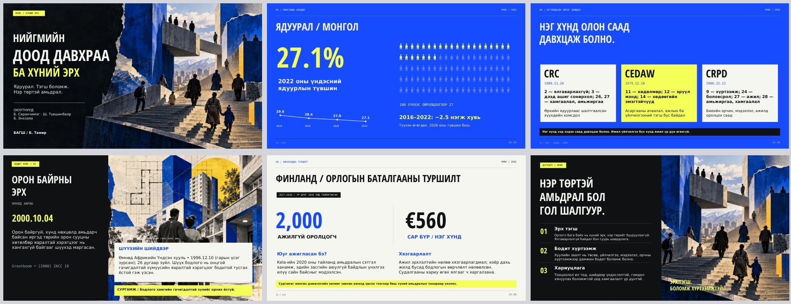

# Нийгмийн доод давхраа ба хүний эрх

МУИС • 30 слайд • Оюутнууд: Б. Саранчимэг, Ш. Түвшинбаяр, Б. Энхзаяа • Багш: Б. Тамир

## Татах

- [PowerPoint — дизайн нь фонт солигдохоос хамаарахгүй үндсэн хувилбар](https://github.com/Online6510/ppts/raw/refs/heads/main/presentation.pptx)
- [PDF — 30 хуудас](https://github.com/Online6510/ppts/raw/refs/heads/main/presentation.pdf)
- [PowerPoint — текст, дүрсүүдийг засварлах хувилбар](https://github.com/Online6510/ppts/raw/refs/heads/main/presentation_editable.pptx)

GitHub дээр файлаа нээгээд **Download raw file** товчоор мөн татаж болно.

## Шинэ дизайн

Архитектурын концепц коллаж, том типографик, асимметр зохиомж, хүний дүрст инфографик, эрх зүйн баримт бичгийн зохиомж, кейсийн постер, дарааллын схемийг агуулгад нь тохируулан ашигласан. Кобальт хөх, хар, цагаан, тод шар өнгийн системтэй. Үндсэн PPTX-ийн слайдуудыг өндөр нягтралтай дүрслэлээр хадгалсан тул төхөөрөмж дээр фонт байхгүй байсан ч зохиомж алдагдахгүй. Илтгэгчийн тайлбар хэвээр. Текст засварлах шаардлагатай бол `presentation_editable.pptx` ашиглана; Open Sans Condensed Bold болон DejaVu Sans фонт шаардлагатай.

## Агуулга ба эх сурвалж

Монголын хууль тогтоомжийн огноо, холбогдох заалт; олон улсын тунхаглал, пакт, конвенц; Өмнөд Африк болон Германы гурван шүүхийн кейс; таван улсын харьцуулалт; Финланд, Бразилын бодлогын жишээ багтсан. Эх сурвалжийн холбоос болон дэлгэрэнгүй тайлбар слайдын **Notes** хэсэгт бий. PDF-ийн сүүлийн хоёр хуудсан дахь эх сурвалжийн нэр дээр дарж холбоосыг нээнэ.

**Хязгаарлалт:** Хууль, статистикийн албан ёсны сайтуудад энэ орчноос хандахад сүлжээний хориг ирсэн тул сүүлийн найруулгыг онлайн тулгаж баталгаажуулаагүй. Хуулийн агуулга нь хураангуй тайлбар, үгчилсэн эшлэл биш. Хэрэглэхийн өмнө анхдагч эхээс нягтална. Ядуурлын график 2016–2022 оны түүхэн өгөгдөл; 2026 оны түвшин биш.

Коллаж зургууд нь AI-гаар бүтээсэн концепц дүрслэл. Шүүхийн хэргийн оролцогч, байршлын бодит гэрэл зураг биш.
